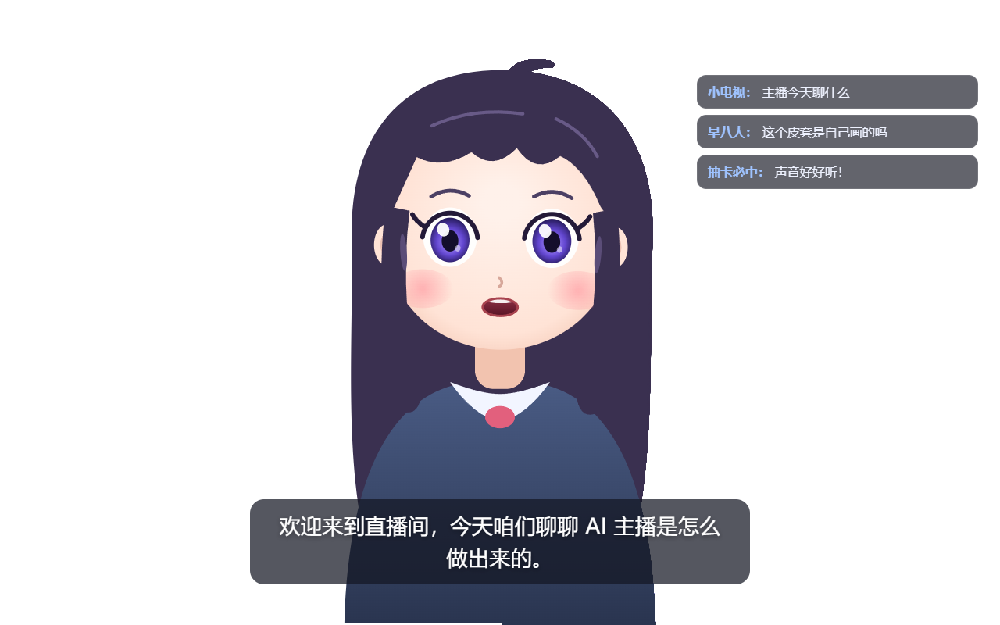

# ai-live · AI 直播最小可播链路

一个纯本地、零外部服务的 AI 虚拟主播原型：**2D 皮套 + 音频驱动口型 + 弹幕回复播报**。
当前里程碑：链路跑通（能说话、嘴会动、能接弹幕），美术是自绘的 Canvas 参数化角色，后续可替换为 Live2D 模型。



## 一条命令跑起来

```
cd ai-live
start.bat            :: 等价于 node server.mjs；Linux/macOS 用 node server.mjs
```

然后浏览器打开 <http://127.0.0.1:8788/puppet.html>：

1. 点「开始」解锁声音（浏览器自动播放策略要求一次手势）；
2. 点右上角「试说一句」，皮套会念一句测试台词，嘴随音量开合；
3. 任何程序 POST `http://127.0.0.1:8788/say`，皮套就会念出来。

## 架构

```
  外部（弹幕机器人 / 定时任务 / curl）
        │  POST /say {text}
        ▼
  server.mjs ── 串行队列 ── python -m edge_tts ──► tmp/*.mp3
        │  SSE /events 推 {type:"say", url, text}
        ▼
  public/puppet.html + puppet.js
        ├─ fetch 音频 → decodeAudioData → AnalyserNode 取 RMS
        └─ Canvas 绘制：口型/眨眼/呼吸/头微动/字幕
```

- **口型来源是音频本身**（AnalyserNode 实时 RMS），不是定时动画，所以和 TTS 音色、语速天然对齐。
- TTS 走 Edge TTS（`pip install edge-tts` 后用 `python -m edge_tts`），免费、无额度概念；换本地 GPT-SoVITS 只需改 `server.mjs` 里的 `runTts()`。
- 服务只监听 `127.0.0.1`，不对外暴露。

## 接口

| 方法 | 路径 | 说明 |
|---|---|---|
| POST | `/say` | body `{"text":"...","voice":"可选"}`，文本上限 300 字（`MAX_CHARS`）。返回 `{"ok":true,"id":"..."}` |
| GET | `/say?text=...` | 同上，方便 curl 手动测试 |
| GET | `/events` | SSE 流，事件 `hello` / `say` / `error` |
| POST | `/danmaku` | body `{"user":"昵称","text":"弹幕"}`，只做右侧浮层展示，**不进 TTS 队列、不占播报** |
| GET | `/health` | 服务状态、当前队列长度、SSE 连接数 |
| GET | `/audio/<文件>` | 播放已合成的 mp3 |

命令行测试：

```powershell
curl.exe -X POST http://127.0.0.1:8788/say -H "Content-Type: application/json" -d "{\"text\":\"测试一句\"}"
```

## 环境变量

| 变量 | 默认 | 说明 |
|---|---|---|
| `PORT` | 8788 | 监听端口 |
| `TTS_VOICE` | zh-CN-XiaoxuanNeural | Edge TTS 音色，可用 `python -m edge_tts --list-voices` 查 |
| `TTS_RATE` | +0% | 语速，如 `+10%` / `-10%` |
| `PYTHON` | python | Python 解释器路径 |
| `MAX_CHARS` | 300 | 单条播报字数上限 |
| `TTS_TIMEOUT_MS` | 45000 | 单条合成超时 |

## OBS 推流接入

1. 装 OBS Studio（<https://obsproject.com>）；
2. 加一个**浏览器**源：URL `http://127.0.0.1:8788/puppet.html?clean=1&auto=1`，尺寸 1080×1350；
3. 勾选「关闭源时关闭页面」；页面 `body` 本身是透明的，OBS 浏览器源默认透明采集，若出现黑底，在该源的「自定义 CSS」里写 `body { background: transparent; }`；
4. 声音：OBS 28+ 的浏览器源有「控制音频通过 OBS 播放」，勾上后皮套的声音直接进推流；或改用「应用程序音频采集」抓 Edge/Chrome；
5. 浏览器源没有点击手势，Chromium 通常允许自动播放；若无声，先在普通浏览器打开同一 URL 点一次「开始」，再切回 OBS。

## 目录

```
ai-live/
  server.mjs          本地服务（静态 + /say + SSE + /health），零 npm 依赖
  public/puppet.html  皮套页面（OBS 浏览器源指向这里）
  public/puppet.js    Canvas 渲染 + 音频 RMS 口型 + SSE 桥
  bots/               弹幕接入与回复（另一条线，见 bots/README）
  tmp/                合成音频与日志，已被 .gitignore 覆盖，可随时整目录清空
  start.bat           一键启动
```

## 已知限制 / 下一步

1. **不是 Live2D**：现在是自绘 Canvas 角色（参数化：口型/眨眼/呼吸/头部微动）。换真 Live2D 需要 `pixi-live2d-display` + Cubism Core + 模型文件，本机 `cdn.jsdelivr.net`、`raw.githubusercontent.com` 均不可达，得先解决素材来源（npm 包或手工下载）。接进来时只需实现 `PuppetAdapter`，把 RMS 映射到 `ParamMouthOpenY`。
2. **口型是音量包络**，不是音素对齐：中文四声/闭唇音会有轻微不同步，观感上可接受；要更准可上 wav2lip/音素对齐，成本高一个量级。
3. **长文本**由调用方切句（单条 ≤300 字），服务端串行排队，不会叠音。
4. **TTS 是 Edge 云端**（不占额度但要联网）。完全离线请换成本地 GPT-SoVITS：改 `runTts()` 成 POST 到 `http://127.0.0.1:9880/tts` 即可，接口形状一致。
5. 音频文件留在 `tmp/`，重启后旧文件仍在（不自动清理，按工作区约定删除需人工确认）。

## 贡献

欢迎 PR，尤其是这几件：**Live2D 适配器**、长文本自动切句、弹幕回复接本地 LLM、OBS 场景文件一键导入、更多 TTS 后端。
跑起来的方式、每个任务的入口文件和约定都写在 [CONTRIBUTING.md](CONTRIBUTING.md)。许可 MIT。

## 安全

- 仅监听 127.0.0.1；不做公网暴露。
- 弹幕凭据只从本地 `config/bilibili.txt`（或 `--cookie-file` 指定的路径）读，代码与日志里不出现内容。
